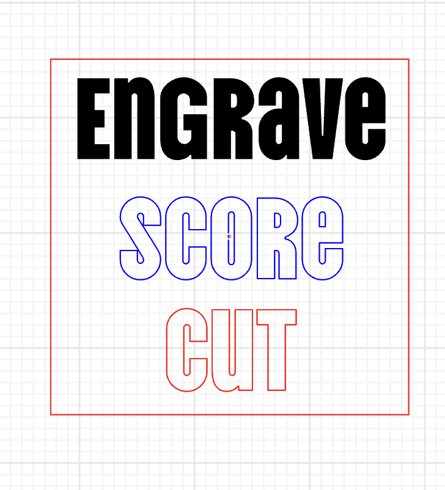
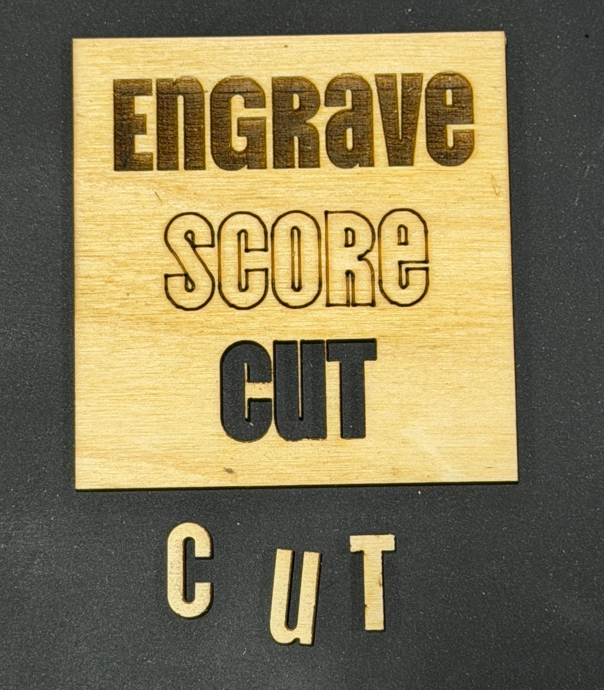

.. _laser-cutting-standards

.. role:: red
.. role:: blue
.. role:: black

Laser Cutting Standards
===========================

Lines and Coloring
********************

* :red:`Red lines (#ff0000)` are where you want to cut (cut through the material)
* :blue:`Blue lines (#0000ff)` are where you want to score (cut into the top of the material)
* :black:`Black lines (#000000)` are where you want to TODO

+---------------------+----------------------+
| |digital_reference| | |physical_reference| |
+---------------------+----------------------+